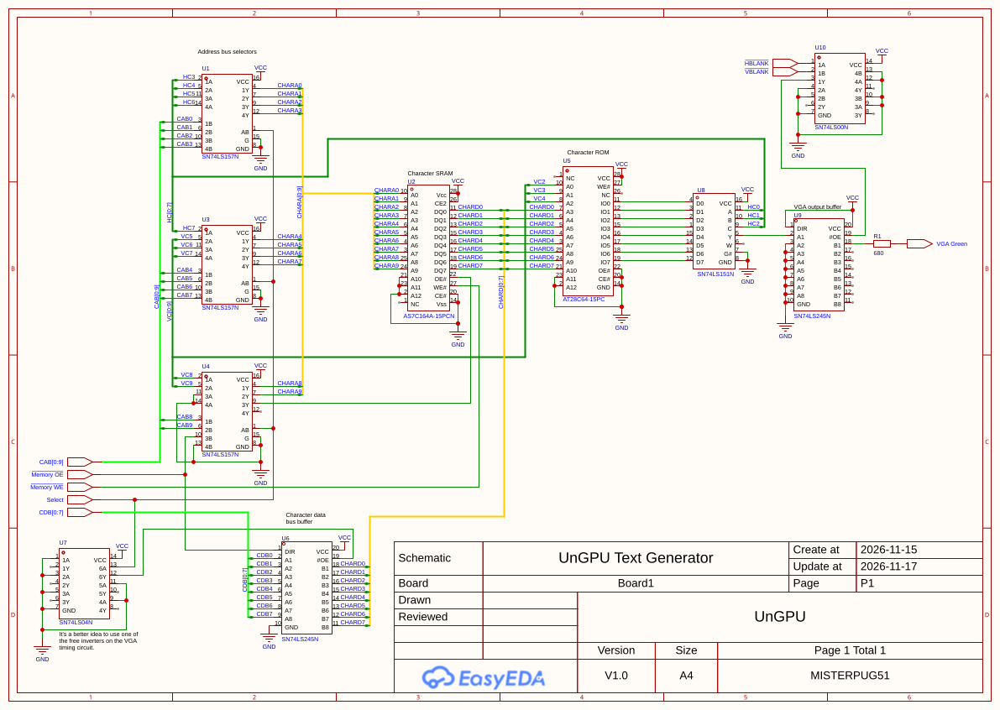

All parts of this project are protected under the [Creative Commons Attribution 4.0 license](https://creativecommons.org/licenses/by/4.0/).
# The UnGPU
The UnGPU is a TTL-based monochrome GPU. This project was inspired by Ben Eater's [World's Worst Video Card](https://eater.net/vga) and Leoneq's [iNapGPU](https://github.com/Leoneq/iNapGPU). It is called the "UnGPU" because it can only display text. You cannot change individual pixels with it.

The UnGPU outputs an 800x600 60Hz VGA signal, but the true resolution is only 200x150 pixels. It uses an 8x8 font to display 25x18 characters. The VGA timing circuitry was borrowed from Ben Eater's World's Worst Video Card. Schematics for the horizontal and vertical timing circuits are available on [his website](https://eater.net/vga). The rest of it is in the schematic below:

CAB0-9 = Computer Address Bus 0-9
 
CDB0-7 = Computer Data Bus 0-7
 
HC0-7 = Horizontal counter bits 0-7
 
VC0-9 = Vertical counter bits 0-9
 
CHARA0-9 = Character RAM address bits 0-9
 
CHARD0-7 = Character RAM data bits 0-7
 
Memory OE (Active low) = Computer VRAM output enable. Used when the computer wants to read data from VRAM.
 
Memory WE (Active low) = Computer VRAM write enable. Used when the computer wants to write data to VRAM.
 
Select = Computer VRAM select signal. Used when the computer is accessing the VRAM.
## VRAM and Character ROM
The characters currently being shown on the screen are stored in VRAM. I used an AS7C164A-15 SRAM chip, with the unused address pins tied to ground.
 
The pixel data for each character is stored in ROM. For this, I used an AT28C64-15 EEPROM.

## Displaying the image
When the computer is not accessing the VRAM, the UnGPU can output to the display.
 
 
First, the current character must be read from the VRAM. The top 5 bits of the VRAM address (CHARA0-CHARA4) represent the character column (0-24). This number is determined by bits 3-7 of the horizontal counter (HC3-HC7). The bottom 5 bits of the VRAM address (CHARA5-CHARA9) represent the character row (0-17). This number is determined by bits 5-9 of the vertical counter (VC5-VC9).
 
 
Next, the pixel data for the current character is read from the ROM. The top 3 bits of the ROM address (A0-A2) are the current row of pixels (VC2-VC4). The next 8 bits (A3-A10) are the current character from the VRAM (CHARD0-CHARD7).
 
 
The Character ROM outputs one row of a character at a time: 1 bit for each of the 8 pixels. A 74LS151 8:1 multiplexer selects which of the 8 pixels is sent to the screen. The 3 select inputs of the multiplexer (A-C) are connected to bits 0-2 of the horizontal counter (HC0-HC2). The multiplexer output (Y) is the current pixel to be sent to the monitor. This signal is connected to a 74LS245 buffer, which is disabled during the display blanking intervals. NOTE: You could probably skip this buffer by using a 74LS251 and disabling the output during blanking, but I don't have that chip.
 
## Reading from/writing to VRAM
There are 3 control signals that the computer drives to access the VRAM: Memory OE (active low), Memory WE (active low), and Select.
 
 
When the computer wants to access the VRAM, it brings the Select signal high. This causes the 3 74LS157 quad multiplexers to connect the VRAM address pins (CHARA0-CHARA9) to the computer address bus (CAB0-CAB9). When the Select signal is high, the character data bus buffer (a 74LS245) is enabled. This buffer connects the VRAM data pins (CHARD0-CHARD7) to the computer data bus (CDB0-CDB7).
 
 
To read from VRAM, the computer brings the Memory OE signal low, the Select signal high, and the Memory WE signal high. To write to VRAM, the computer first brings all 3 control signals high. Next, the data to be written is put onto the data bus. Once this is complete, the computer momentarily brings the Memory WE signal low to write the data. The Memory OE signal should NEVER be low (enabled) at the same time as the computer is driving the data bus.
 
 
This method of accessing the VRAM has one annoying consequence: Since the GPU cannot control the VRAM address, garbage data will be sent to the monitor while the computer is accessing the VRAM.
